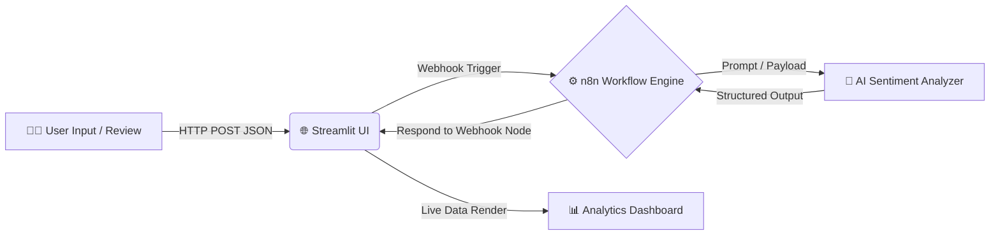

<div align="center">

# ⚡ FeedSense AI
### Automated Customer Feedback Intelligence & Real-Time Sentiment Orchestration

[](https://streamlit.io/)
[](https://n8n.io/)
[](https://python.org)
[](https://opensource.org/licenses/MIT)

<p align="center">
  <b>Turn raw customer reviews into instant, actionable business insights.</b><br>
  Powered by an event-driven n8n pipeline, LLM intelligence, and a sleek Streamlit UI.
</p>

---

[Key Highlights](#-key-highlights) • 
[System Architecture](#-system-architecture) • 
[Installation](#-quickstart) • 
[n8n Workflow Setup](#-n8n-workflow-configuration) • 
[Environment Variables](#-environment-configuration)

---

</div>

## 🎯 What is FeedSense AI?

Processing high-volume feedback manually leads to delayed responses and missed customer pain points. **FeedSense AI** automates this pipeline entirely:

1. **Captures** feedback instantly via a modern UI.
2. **Streams** payload payloads directly to an event-driven **n8n orchestration workflow**.
3. **Analyzes** text using LLMs to infer sentiment, isolate complaints, and synthesize support recommendations.
4. **Responds** synchronously in real time, rendering metrics and actionable steps in under 2 seconds.

---

## ✨ Key Highlights

| Feature | Description |
| :--- | :--- |
| 🎨 **Dynamic Dashboard** | Modern glassmorphic cards, responsive metric indicators, and real-time execution status. |
| ⚡ **Zero-Code Orchestration** | Visual, modifiable automation pipeline utilizing `n8n` webhooks and data transformers. |
| 🧠 **Deep Linguistic Analysis** | Classifies sentiment, extracts root friction points, and formulates automated team responses. |
| 🔒 **Enterprise-Ready Security** | Fully sandboxed credentials via `.env` with strict `.gitignore` rules preventing secret leaks. |

---

## 🏛️ System Architecture



---

## 📂 Project Structure

```bash
n8n/
├── 📄 Customer_feedback_intelligence.json   # Exported, production-ready n8n workflow
├── 🐍 app.py                                # Streamlit frontend application
├── 📦 requirement.txt                       # Python dependencies (Streamlit, Requests, etc.)
├── 🔐 .env.example                          # Safe environment variable blueprint
├── 🛡️ .gitignore                            # Enforces private key protection
└── 📖 Readme.md                             # Repository showcase documentation
```

---

## 🚀 Quickstart

### 1. Clone & Enter Repository
```bash
git clone https://github.com/<your-username>/<your-repo-name>.git
cd <your-repo-name>
```

### 2. Configure Environment
```bash
# Duplicate template into active .env
cp .env.example .env
```
Ensure your `.env` contains:
```env
N8N_WEBHOOK_URL=http://localhost:5678/webhook/feedback
```

### 3. Install Dependencies
```bash
pip install -r requirement.txt
```

### 4. Launch the App
```bash
python -m streamlit run app.py
```
> The dashboard will immediately spin up at `http://localhost:8501`.

---

## ⚙️ n8n Workflow Configuration

To connect the UI to your automated backend:

<details>
<summary><b>Click to expand step-by-step setup</b></summary>
<br>

1. **Import Workflow:**
   * Open your local or cloud n8n dashboard (`http://localhost:5678`).
   * Navigate to **Workflows** → Click **Import from File**.
   * Select `Customer_feedback_intelligence.json`.

2. **Configure Webhook Trigger:**
   * **HTTP Method:** `POST`
   * **Path:** `feedback`
   * **Response Mode:** `Using 'Respond to Webhook' Node` *(Critical for sync responses)*

3. **Respond to Webhook Node:**
   * Ensure the final node outputs valid JSON matching this schema:

```json
{
  "sentiment": "Positive",
  "key_issues": "No major blockers reported",
  "suggested_action": "Acknowledge review and dispatch loyalty voucher."
}
```

4. **Activate:** Toggle the workflow from **Inactive** to **Active**.
</details>

---

## 📦 Tech Stack

- **Frontend & Visuals:** [Streamlit](https://streamlit.io/)
- **Automation & Pipeline:** [n8n.io](https://n8n.io/)
- **Core Runtime:** [Python 3.9+](https://www.python.org/)
- **Networking:** [Requests](https://requests.readthedocs.io/)

---

<div align="center">

Made with ❤️ for scalable AI automation pipelines.........

**[⬆ Back to Top](#-feedsense-ai)**

</div>